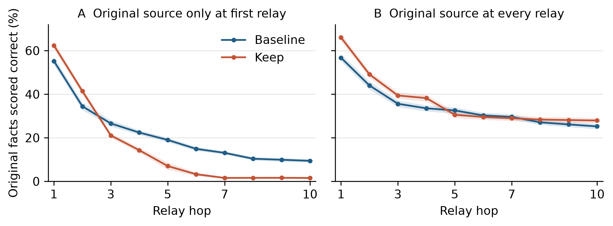

# Information Retention in Chains of Language Model Agents

**Marco D'Addezio** · Exploratory research report · 20 November 2026

[Read the paper (PDF)](paper/manuscript.pdf) · [LaTeX source](paper/manuscript.tex)

When agents keep rewriting a short handoff note as new material arrives, which facts survive? This experiment follows 80 synthetic business documents through 960 ten-relay chains. Claude Haiku subagents ran in shared Claude Code batches. Each relay was asked to write at most 67 words.

In chains where agents could see the original document only at the first relay, a prompt to preserve specifics helped at the first two relays. The pattern reversed at relay three. By relay ten, **9.4%** of original facts were scored correct with the baseline prompt and **1.6%** with the preservation instruction. The preservation notes contained more incoming facts per word.

| Original document access | Baseline at relay 10 | Preserve specifics at relay 10 | Difference |
| --- | ---: | ---: | ---: |
| First relay only | 440 / 4,674 (9.4%) | 73 / 4,674 (1.6%) | −7.85 percentage points |
| Every relay | 1,179 / 4,674 (25.2%) | 1,305 / 4,674 (27.9%) | +2.70 percentage points |

Each batch shared a subagent context. Effects varied across the three replicates, and the small pooled gain with repeated source access depended on code retention. The bands show pointwise document bootstrap intervals conditional on the recorded run. The author's blinded spot check agreed with both scoring versions on 93 facts in five notes, including 85 omissions. It contained no paired prompt comparison.

## Reproduce the headline result

From the repository root, with Python 3.11 or later:

    python3 -m venv .venv
    .venv/bin/python -m pip install -r requirements.txt
    .venv/bin/python reproduce.py

The last command prints the four original-fact retention rates, the two prompt differences, and the 95% paired document bootstrap intervals. To regenerate the plot:

    .venv/bin/python reproduce.py --figure retention.png

The script works offline after installing the dependencies. It uses archived scores and does not call the models. An independent rerun with one fresh context per request would test whether the reversal recurs outside the recorded batches.

[data/results_main.csv.gz](data/results_main.csv.gz) contains the 584,484 archived scored rows with structured identifiers and scoring fields. The headline calculation selects original facts at relay ten and counts rows with `status_v3 = kept`. Both scoring versions appear in the release data. [data/human_spot_check.csv](data/human_spot_check.csv) contains the 93 completed human labels, joinable by `chain_id`, `k` and `fact_id`. [data/manifest.json](data/manifest.json) records the released fields, file hashes and bootstrap settings.

## Build the paper

With TeX Live or MacTeX:

    cd paper
    latexmk -pdf -outdir=build manuscript.tex

The source, bibliography and nine vector figures are included. The build writes `paper/build/manuscript.pdf` relative to the repository root.

## Contributions

Marco D'Addezio documented the experiment, reviewed the interpretation, and personally supplied the 93 human judgments. Claude Code assisted with implementation and orchestration. Claude Haiku generated the notes, Claude Sonnet extracted and judged facts, and deterministic code computed the statistics. Codex assisted with the independent reanalysis, manuscript preparation and reproduction package. The paper acknowledges Yacine Touati for the motivating question and Anthropic for support through the Claude Team plan for scientists.
